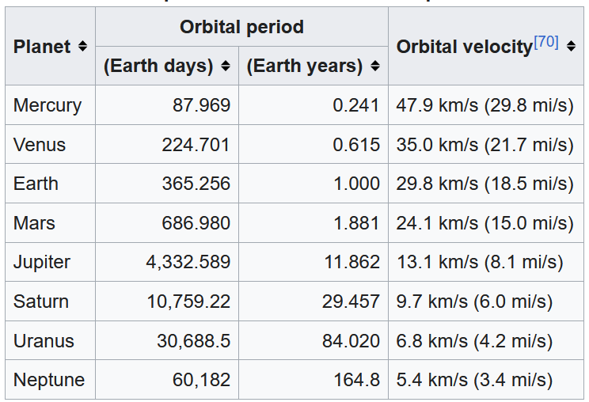

# Lesson 11 - Practice

In this practice, you will be making a website in HTML about the planets of the Solar System.

We will be using the Wikipedia page Solar System as the source for text and images: https://en.wikipedia.org/wiki/Solar_System

Create your 11-practice.html file and add boilerplate HTML to it.

## Problem 1:

Make the title of the website "The Solar System".

## Problem 2:

Add header, main, and footer tags to the body.

## Problem 3:

In the header, add the following navigation links:

- Home
- Sun
- Planets
- Asteroids
- Comets

## Problem 4:

In the main tag, add a headline that will be the title of the website, with the following text: "The Solar System".

## Problem 5:

Download the following image of the solar system from Wikipedia. (I recommend the Medium size): https://en.wikipedia.org/wiki/Solar_System#/media/File:Solar_System_True_Color_EN.png

Create a folder in the "practice" folder, or otherwise on the same level as your HTML file, called "images" and put the image there.

Add the image after the main headline. Make the image 400 pixels wide. (Bonus if you can set the correct height)

Add alt text to the image that says: "The planets and the Sun of the Solar System, in true color and size."

## Problem 6:

After the image, add a paragraph with the following text:

"The Solar System is the gravitationally bound system of the Sun and the masses that orbit it, most prominently its eight planets, of which Earth is one."

Make the words "Solar System" in bold.

Make the word "Earth" in italics.

## Problem 7:

Let's make another section of content after the paragraph.

In it, add a headline with the text "Formation and evolution".

Under the headline, add a paragraph tag with the following text:

"The Solar System formed at least 4.568 billion years ago from the gravitational collapse of a region within a large molecular cloud. This initial cloud was likely several light-years across and probably birthed several stars."

And a second paragraph with the text:

"The Solar System remains in a relatively stable, slowly evolving state by following isolated, gravitationally bound orbits around the Sun."

## Problem 8:

Below the paragraphs, add a new headline that reads, "Orbital periods and velocities of the planets".

Add a paragraph that reads:

"The planets and other large objects in orbit around the Sun lie near the invariable plane of the Solar System, as does Earth's orbit, known as the ecliptic, and most closely the orbit of Jupiter, with an inclination to it of 0.3219°."

## Problem 9:

Recreate the table from the Wikipedia page, linked [here.](https://en.wikipedia.org/wiki/Solar_System#mwAmE)

Image for additional reference:

Add the deprecated attribute `border="1"` to add borders to the table.

HINT: You will need to use both rowspan and colspan.

## Problem 10:

Divide up the content in the main tag into 3 sections, using section tags.

## Problem 11:

Add a footer tag, and in it, put a copy the nav element from the header.

## Problem 12:

In the footer, before the nav, add a link to the Wikipedia URL (https://en.wikipedia.org/wiki/Solar_System) with link text that reads:

"Image and text from Wikipedia.org".

Make the link open in a new tab.
